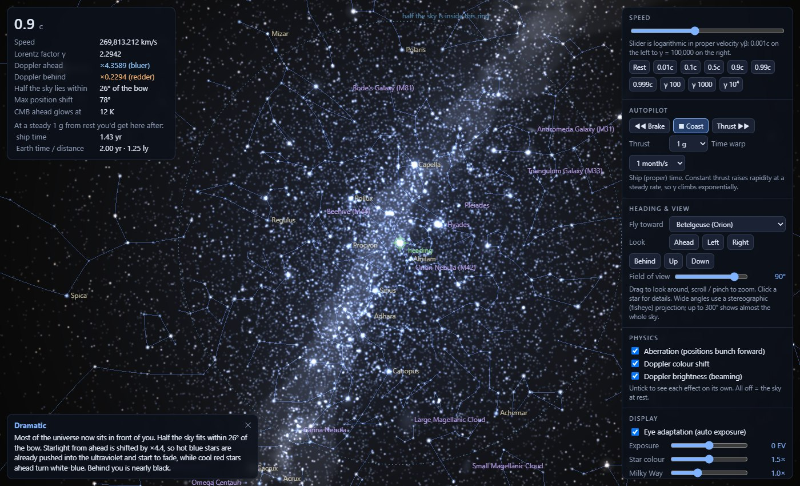

# Relativistic View

**[▶ Launch the live app](https://hughesalex.github.io/RelativisticView/starship.html)**

A single-page WebGL app that shows what you would see from a spacecraft accelerating towards the speed of light.

At low speeds the sky looks the same in every direction. As you speed up, three effects of special relativity build up:

- **Aberration.** Stars bunch towards your direction of travel. At 0.9c, half the sky is squeezed into a cone 26° across around the bow.
- **Doppler colour shift.** Each star's blackbody spectrum is shifted, so stars ahead look hotter and bluer, and stars behind look cooler and redder.
- **Beaming.** Stars ahead get brighter and stars behind fade. At extreme speeds, stars ahead also fade, because their light shifts into the ultraviolet. Above γ ≈ 150, the cosmic microwave background starts to glow dead ahead.

## Features

- **Real sky:** about 41,000 stars down to magnitude 8 from the HYG catalogue, plus the Milky Way, the Andromeda and Triangulum galaxies, the Magellanic Clouds, bright nebulae and clusters, and the CMB.
- **Speed slider:** logarithmic, from 0.001c up to γ = 100,000, with presets.
- **Autopilot:** constant thrust (0.1–100 g) with time warp.
- **Look around:** drag to change the view direction, and zoom from 0.05° to a 300° fisheye.
- **Toggles:** switch each effect on or off on its own, and turn on constellation lines, labels and guide rings.
- **Readouts:** a live display of β, γ and the Doppler factors, a panel explaining what you're seeing at the current speed, and click-to-inspect star details.

Everything is in one self-contained HTML file with no dependencies. It needs a browser with WebGL 2.

## Data sources

- Stars: [HYG database](https://github.com/astronexus/HYG-Database) v3.8
- Milky Way outline and constellation lines: [d3-celestial](https://github.com/ofrohn/d3-celestial)
